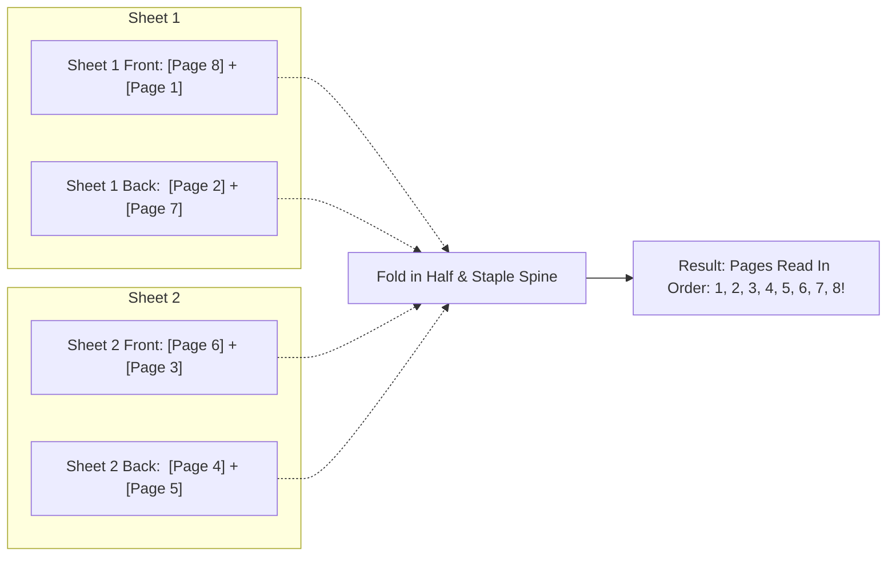

# 🖨️ PrintSmart — Visual Print Planner, 3D Duplex Simulator & Imposition Engine

[](https://react.dev/)
[](https://vitejs.dev/)
[](https://tailwindcss.com/)
[](https://pdf-lib.js.org/)
[](https://mozilla.github.io/pdf.js/)
[](LICENSE)
[](https://github.com)

> **Stop wasting paper and ink on upside-down duplex printouts.**  
> PrintSmart is a web application that calculates imposition layouts (2-in-1, 4-in-1, foldable booklets), simulates paper flips in interactive 3D, connects with your printers, and compiles print-ready PDFs directly in your browser.

---

## 🌟 Key Features

### 1. ⚡ Dual UX: Simple Mode vs Pro Mode
- **⚡ Simple Mode (Default for New Users)**:
  - Zero jargon, clean layout designed to eliminate confusion.
  - **4 Clear Print Style Cards**:
    - 📑 **2-in-1 Eco Save**: 2 pages per sheet side (*Saves 50% paper — Recommended for lecture notes*).
    - 📄 **1-Page Standard**: Classic 1:1 single or double-sided printing.
    - 📖 **Folded Booklet**: Center-fold & saddle-stitch into a mini pocketbook.
    - 📋 **4-in-1 Handout**: 4 slides/pages per sheet side (*Saves 75% paper — Ideal for presentations*).
  - One-toggle **Double-Sided Printing** with plain-English flip choices (*"Like a Normal Book"* vs *"Like a Notepad"*).
- **🛠️ Pro Mode (1-Click Toggle)**:
  - Granular control over N-up grids (1, 2, 4, 6, 9), custom paper margins (0mm to 25mm), binding positions (staples, spiral, comb), page range filtering (`1-3, 5, 8-12`), and commercial Print Shop counter rate slips.

### 2. 🖨️ Printer Connection Hub & 1-Click Direct Print
- **Device Management**:
  - Automatically pairs with system print spoolers and detects local Wi-Fi, AirPrint, Mopria, and USB devices (HP LaserJet, Canon PIXMA, Epson EcoTank, Brother Laser).
  - Displays hardware duplex support, paper tray status (*A4 / Letter loaded*), and live ink/toner level gauges.
- **Wi-Fi Scanner**:
  - Scan local network to discover printers, or connect via custom IP/hostname.
- **Calibration / Test Print**:
  - Generates and prints a calibration test sheet to test your printer's tray feed direction before large print runs.
- **Direct Browser Print**:
  - One-click **Print Now** button dispatches imposed sheets directly to your printer with zero software installation.

### 3. 🔄 3D Paper & Flip Physics Simulator
- Interactive 3D physical sheet simulator lets you inspect both sheet faces before printing.
- Demonstrates the difference between **Long-Edge Binding** (turning like a book) and **Short-Edge Binding** (turning like a notepad/calendar).
- Renders physical finishing marks including staples, spiral coils, and comb rings on the sheet margins.

### 4. 📖 3D Folded Booklet Lifecycle Viewer
- Visualizes how 16-page or multi-page booklets fold, collate, and nest into saddle-stitched signatures.
- Animates the entire booklet journey: **Flat Imposed Sheet ➔ Center Fold ➔ Spine Stapling ➔ Final Leaf Flipping**.

### 5. 📥 Fast & Robust PDF Imposition Engine
- Powered by `pdf-lib` and `pdfjs-dist`.
- Runs **100% in browser memory**: zero files are uploaded to third-party servers (*100% confidential and GDPR-compliant*).
- Exports print-ready PDF files with accurate margins, sheet numbering, and rotation angles.

### 6. 📱 Mobile & Tablet Responsive
- Fully optimized responsive design from 390px mobile screens to 4K desktop displays.
- Large touch targets (48px+), swipe-friendly previews, and scrollable modal sheets.

---

## 🏗️ Architecture & Workflows

### System Workflow Diagram
```mermaid
flowchart TD
    A[User Selects Document] -->|Upload PDF or Demo Sample| B[Document Parser (pdfjs-dist)]
    B --> C{Choose Experience}
    C -->|Simple Mode| D[4 Visual Presets: Eco 2-Up, Standard, Booklet, Handout 4-Up]
    C -->|Pro Mode| E[Custom N-Up, Margins, Binding Finish, Page Range]
    D --> F[Core Imposition Calculator (imposition.js)]
    E --> F
    F --> G[Generate Physical Sheet Mapping]
    G --> H[Interactive 3D Physical Simulator (PhysicalSimulator.jsx)]
    G --> I[Booklet Lifecycle Viewer (BookletLifecycleViewer.jsx)]
    H --> J{Action}
    I --> J
    J -->|Direct Print| K[Printer Connection Hub & Browser Print Engine]
    J -->|Download PDF| L[Print-Ready Compiler (pdf-lib)]
    L --> M[Exported Print-Ready PDF]
```

### Booklet Imposition Mapping (How It Works)
When printing an 8-page booklet on 2 physical sheets:



---

## 🚀 Getting Started on Any Machine

Follow these simple steps to run PrintSmart locally on **Windows**, **macOS**, or **Linux**.

### Prerequisites
Make sure you have [Node.js](https://nodejs.org/) installed:
- **Node.js**: `v18.0.0` or higher (Recommended: `v20.x` or `v22.x LTS`)
- **npm**: `v9.0.0` or higher (included with Node.js)

Verify your installation:
```bash
node -v
npm -v
```

---

### Step-by-Step Installation

#### 1. Clone the Repository
```bash
git clone https://github.com/maheshgayakwad007/noteshub.git
cd noteshub
```

#### 2. Install Dependencies
```bash
npm install
```

#### 3. Start the Development Server
```bash
npm run dev
```

The terminal will display your local server address:
```
  VITE v8.3.x  ready in 320 ms

  ➜  Local:   http://localhost:5173/
  ➜  Network: use --host to expose
```
Open **`http://localhost:5173/`** in your browser (Google Chrome, Microsoft Edge, Mozilla Firefox, or Safari).

---

### 📦 Production Build & Deployment

To compile an optimized production bundle:

```bash
npm run build
```
This generates static files inside the `dist/` directory.

To test the production build locally:
```bash
npm run preview
```

#### Deploying to Hosting Platforms
Because PrintSmart is a client-side Single Page Application (SPA), the `dist/` folder can be hosted anywhere:
- **Vercel**: Import the GitHub repo; build command is `npm run build`, output directory is `dist`.
- **Netlify**: Set publish directory to `dist`.
- **GitHub Pages**: Deploy the contents of `dist` using `gh-pages` or GitHub Actions.
- **Firebase Hosting**: Run `firebase deploy`.

---

## 📂 Project Structure

```
PrintView/
├── public/                 # Static public assets
├── src/
│   ├── assets/             # Branding icons and static assets
│   ├── components/         # Reusable UI components
│   │   ├── BindingOverlay.jsx         # Visual representation of staples, spiral, & comb
│   │   ├── BookletLifecycleViewer.jsx # 3D booklet folding & page flip simulation
│   │   ├── ControlPanel.jsx           # Granular imposition parameters
│   │   ├── FlipEducationModal.jsx     # Visual guide to Long Edge vs Short Edge
│   │   ├── JobTicketModal.jsx         # Printable commercial print shop invoice
│   │   ├── ManualDuplexWizard.jsx     # Step-by-step printer feed tray reload wizard
│   │   ├── Navbar.jsx                 # Top bar with device status & Simple/Pro toggle
│   │   ├── PaperCalculator.jsx        # Paper sheets, cost, & carbon savings calculator
│   │   ├── PDFUploader.jsx            # Drag-and-drop uploader + instant sample presets
│   │   ├── PhysicalSimulator.jsx      # 3D interactive paper flip physics engine
│   │   ├── PreflightWarnings.jsx      # Resolution, margin, and orientation checks
│   │   ├── PrinterConnectionModal.jsx # Printer device manager, Wi-Fi scan & calibration
│   │   └── StepProgress.jsx           # 4-step wizard navigation
│   ├── pages/              # Primary application views
│   │   ├── UploadPage.jsx             # Step 1: Document selection
│   │   ├── SettingsPage.jsx           # Step 2: Print style (Simple & Pro mode)
│   │   ├── PreviewPage.jsx            # Step 3: 3D paper simulator & booklet preview
│   │   └── SummaryPage.jsx            # Step 4: Print to printer & download PDF
│   ├── utils/              # Calculation & document engines
│   │   ├── costCalculator.js          # Paper sheet & financial savings estimator
│   │   ├── imposition.js              # N-Up & Booklet mathematical sheet mapping
│   │   ├── pdfEngine.js               # pdfjs-dist renderer & pdf-lib PDF compiler
│   │   └── samplePdfGenerator.js      # Built-in demo lecture notes, slides, and booklets
│   ├── App.jsx             # Root application orchestrator
│   ├── index.css           # TailwindCSS setup, 3D animations, & print media queries
│   └── main.jsx            # React root mount point
├── package.json            # Project dependencies and npm scripts
└── vite.config.js          # Vite configuration
```

---

## 🧭 How to Use: A Quick Walkthrough

### Step 1: Select Your Document
- Drag and drop any multi-page PDF file into the drop zone.
- Alternatively, click any of the **4 instant sample documents** (*Lecture Notes, Financial Slides, Project Booklet, or Thesis*) to test right away.

### Step 2: Choose Your Print Style
- **Simple Mode**:
  - Choose one of the 4 clear cards:
    - 📑 **2-in-1 Eco Save** *(Most popular for study notes)*
    - 📄 **1-Page Standard**
    - 📖 **Folded Booklet**
    - 📋 **4-in-1 Handout**
  - Select whether to print double-sided and whether pages flip along the long side (*Book style*) or short side (*Notepad style*).
- **Pro Mode**: Click **"Switch to Pro Options"** to configure custom margins, binding punch holes, or page ranges.

### Step 3: Test in 3D Preview
- Click **"Flip Sheet"** to watch the paper turn in 3D.
- Verify that back-side pages are right-side-up and that margin bindings don't cut off text.
- If Booklet format was chosen, switch to **"Booklet Fold & Staple Guide"** to inspect how folded sheets nest together.

### Step 4: Print or Download
- **Print Directly**: Click **"Print with Printer"** to send the imposed job straight to your system or Wi-Fi printer.
- **Connect / Calibrate**: Click **"Change / Connect Printer"** to view toner levels or run a test alignment sheet.
- **Download PDF**: Click **"Download Print-Ready PDF"** to save the imposed PDF to your computer or mobile device.

---

## ❓ Frequently Asked Questions (FAQ)

### 1. Why do back pages come out upside-down on my printer?
This occurs when the duplex flip setting does not match the page orientation:
- **Portrait Documents**: Flip on the **Long Edge** (turns left-to-right like a novel).
- **Landscape Documents / 2-Up Slides**: Flip on the **Short Edge** (turns top-to-bottom like a wall calendar).  
*PrintSmart's 3D simulator shows you this exact motion before you print!*

### 2. My printer does not have automatic double-sided printing. Can I still use this?
**Yes!** Click **"Manual Duplex Paper Feed Guide"** on Step 4. PrintSmart provides a step-by-step reload wizard and a calibration test pattern so you know whether your printer's tray feeds paper face-up or face-down.

### 3. Are my PDF documents secure?
**100% Yes.** All processing happens locally in your browser's JavaScript engine using WebAssembly and HTML5 Canvas. Your documents are never uploaded to any cloud server or third party.

---

## 🛠️ Tech Stack & Libraries

- **Framework**: [React 19](https://react.dev/)
- **Build Tool**: [Vite 8](https://vitejs.dev/)
- **Styling**: [Tailwind CSS v4](https://tailwindcss.com/)
- **PDF Parsing & Thumbnail Rendering**: [PDF.js (`pdfjs-dist`)](https://mozilla.github.io/pdf.js/)
- **PDF Imposition & Generation**: [pdf-lib](https://pdf-lib.js.org/)
- **Icons**: [Lucide React](https://lucide.dev/)
- **Linter**: [Oxlint](https://oxc.rs/)

---

## 📄 License

This project is licensed under the **MIT License** — you are free to use, modify, and distribute it for personal, educational, or commercial projects.
